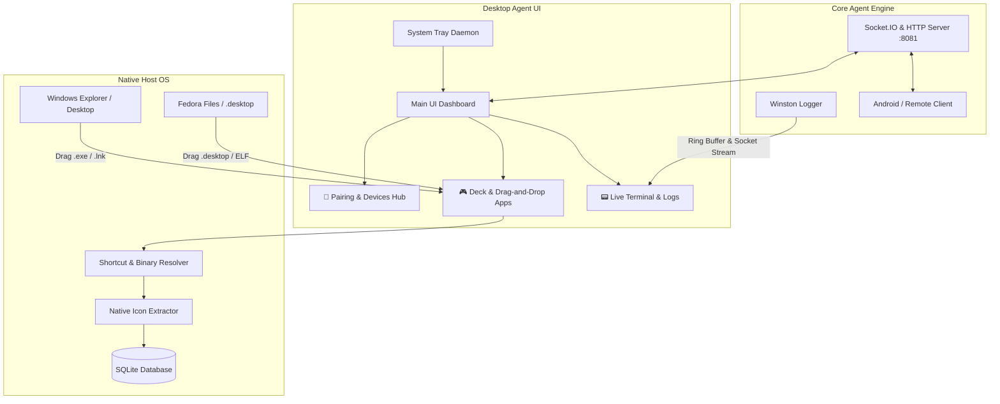
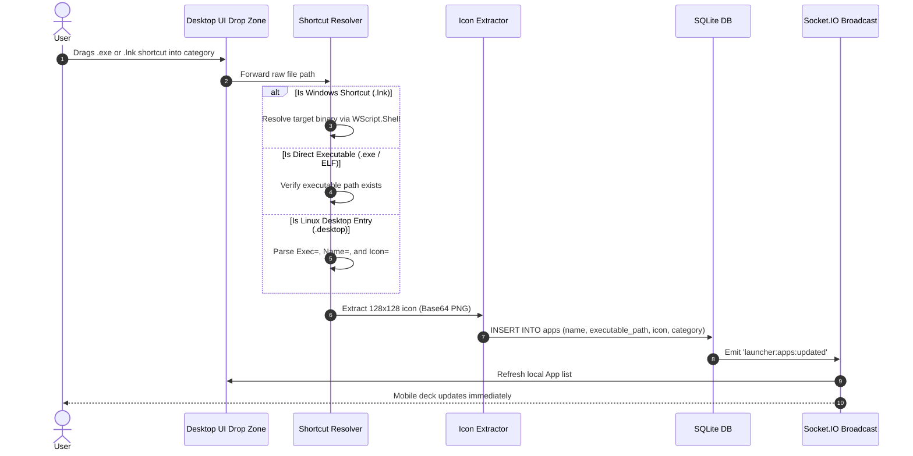

# DevDeck Desktop Agent UI: Implementation Plan

> **Goal**: Replace the command-line terminal agent with a standalone desktop GUI application.  
> **Key Capabilities**: Native application drag-and-drop, real-time log monitoring (virtual terminal), pairing hub with live QR code, system tray daemon integration, and cross-platform architecture (Windows ➔ Linux Fedora).

---

## 1. Executive Summary & Problem Definition

### Current State
Currently, running `desktop-agent` launches a standard command-line console (`cmd.exe` / `powershell.exe`). 
* **Pain Points**:
  1. Closing the terminal kills the agent process.
  2. Users must read text logs directly from the terminal console.
  3. Pairing QR codes are printed as ASCII blocks in terminal output.
  4. Applications can only be registered manually through database seeding, system scanning, or the mobile app—there is no visual drag-and-drop.

### Target State
A native, lightweight desktop GUI application acting as the control hub for the DevDeck Agent:
* Sits in the **System Tray** and runs in the background.
* Allows users to **drag and drop** `.exe` files or shortcuts (`.lnk`) directly into deck categories.
* Features an **embedded live terminal** with colorized Winston log streaming, pause/filter controls, and auto-scroll.
* Displays a **Pairing Hub** with high-resolution QR codes, local IP addresses, and connected mobile devices.
* Architected cleanly to run on **Windows** now and compile natively for **Linux Fedora** (Wayland/X11) later.



---

## 2. Deep Dive: Core Logic & Technical Mechanics

### 2.1 Drag-and-Drop Application Registration Logic

Standard web browsers in an ordinary sandbox intentionally strip the absolute path of dropped files (e.g. `C:\Program Files\...\app.exe` is inaccessible). The Desktop UI requires native OS drop integration.



#### Windows Shortcut (`.lnk`) Resolution
Windows desktop and Start Menu shortcuts are binary shell links. The resolver queries the true target binary path:
```typescript
import { exec } from 'child_process';

export function resolveWindowsShortcut(lnkPath: string): Promise<string> {
  return new Promise((resolve, reject) => {
    const ps = `(New-Object -ComObject WScript.Shell).CreateShortcut('${lnkPath.replace(/'/g, "''")}').TargetPath`;
    exec(`powershell -NoProfile -Command "${ps}"`, (err, stdout) => {
      if (err || !stdout.trim()) {
        return resolve(lnkPath); // fallback to original path
      }
      resolve(stdout.trim());
    });
  });
}
```

---

### 2.2 Live Terminal & Log Streaming Pipeline

To mirror the terminal experience inside the app, the agent implements a streaming log pipeline:

1. **In-Memory Ring Buffer (Last 500 lines)**: Ensures that whenever the UI window opens or refreshes, historical logs are rendered immediately without reading disk files.
2. **Winston Socket Transport**: An event-driven transport that intercepts every log record (`info`, `warn`, `error`) and broadcasts it to connected UI clients.
3. **Virtual Terminal Console Widget**:
   * Monospace font (JetBrains Mono / Fira Code).
   * Color-coded log levels (Cyan = `INFO`, Yellow = `WARN`, Red = `ERROR`, Magenta = `DEBUG`).
   * Search / Filter input.
   * Auto-scroll toggle and "Copy All" button.

---

### 2.3 System Tray & Background Daemon Lifecycle

* **Close Window Behavior**: Clicking `X` does **not** terminate the server. It hides the window to the system tray.
* **Tray Context Menu**:
  * `Open Dashboard`
  * `Status: Server Active (Port 8081)`
  * `Restart Agent`
  * `Exit DevDeck`
* **Single Instance Lock**: Prevents multiple agent processes from starting simultaneously and throwing `EADDRINUSE` errors on port 8081.

---

## 3. Technology Evaluation: Framework Options

| Architecture Aspect | Option A: **Electron Shell for `desktop-agent`** *(Recommended)* | Option B: **Flutter Desktop Companion** |
| :--- | :--- | :--- |
| **Location** | Integrated into `desktop-agent/` | Uses existing Flutter project in `lib/` |
| **Native Drag & Drop** | Native via Electron Renderer (`file.path` is preserved) | Native via `desktop_drop` package |
| **System Tray** | Built-in via Electron `Tray` API | Via `tray_manager` Flutter package |
| **Resource Usage** | ~75–90 MB RAM | ~35–45 MB RAM |
| **Cross-Platform** | Identical on Windows & Linux Fedora (`electron-builder`) | Compiles via `flutter build windows` & `linux` |
| **Development Speed** | Single Node.js/TypeScript stack, direct IPC | Requires Flutter C++ runner tools on Windows |

> [!TIP]
> **Why Option A is Recommended for the Agent**:
> It keeps the `desktop-agent` completely self-contained. The Node.js server, SQLite database, native icon extractors, tray manager, and UI live in a single repository folder without needing external Flutter desktop build tools.

---

## 4. UI Layout & Wireframe Specification

The Desktop UI is structured into a modern dark-mode sidebar layout:

```
+-----------------------------------------------------------------------------------+
|  [⚡ DevDeck Agent]            [● Server Running :8081]        [ _ ] [ □ ] [ ✕ ] |
+------------------+----------------------------------------------------------------+
|                  |  📱 PAIRING & CONNECTION HUB                                   |
|  [📱 Pairing]    |  +------------------------+  +-------------------------------+ |
|                  |  |  [QR CODE PREVIEW]     |  | Host IP: 192.168.1.105:8081   | |
|  [🎮 Deck Apps]  |  |                        |  | Pairing Token: a8f4...e9      | |
|                  |  |                        |  | Active Devices: 1 Connected   | |
|  [📟 Terminal]   |  +------------------------+  +-------------------------------+ |
|                  |                                                                |
|  [⚙️ Settings]   |  🎮 DRAG & DROP APPLICATION MANAGER                            |
|                  |  +-----------------------------------------------------------+ |
|                  |  |  📂 [ DROP EXECUTABLE / SHORTCUT HERE TO REGISTER ]       | |
|                  |  +-----------------------------------------------------------+ |
|                  |  Categories: [Developer (3)] [Utility (2)] [Media (1)]       | |
|                  |                                                                |
|                  |  📟 LIVE AGENT TERMINAL                                        |
|                  |  +-----------------------------------------------------------+ |
|                  |  | [22:45:01] INFO : 🚀 Socket.IO Server running on port 8081| |
|                  |  | [22:45:04] INFO : 🔌 Client authenticated: Pixel 8 Pro     | |
|                  |  | [22:45:10] INFO : 📋 Clipboard synced with remote device   | |
|                  |  +-----------------------------------------------------------+ |
|                  |  [Filter: All ▼] [Auto-scroll ☑] [Clear] [Copy Logs]           |
+------------------+----------------------------------------------------------------+
```

---

## 5. Detailed Step-by-Step Implementation Roadmap

### Phase 1: Backend Agent Upgrades (Node.js / TypeScript)

1. **Winston Ring Buffer & Stream Event**:
   * Add a circular in-memory queue to [src/core/logger/winston.ts](file:///c:/Users/NITIN/Desktop/devdeck/desktop-agent/src/core/logger/winston.ts).
   * Emit `logs:history` on initial UI connection, and `logs:stream` on every new entry.
2. **Shortcut & File Drop Handler**:
   * Create `src/utils/shortcutResolver.ts` to convert Windows `.lnk` shortcuts to target `.exe` paths.
   * Add socket event `launcher:register-from-file` in `socketEvents.ts`.
3. **Pairing State API**:
   * Expose pairing status, network IPs, and connected sockets through internal IPC / Socket events.

---

### Phase 2: Desktop Window & Tray Lifecycle

1. **Window Management**:
   * Create standard BrowserWindow with custom dark-themed titlebar.
   * Handle single-instance lock (`app.requestSingleInstanceLock()`).
2. **System Tray Integration**:
   * Create tray icon with live connection status tooltip.
   * Implement minimize-to-tray on window close (`event.preventDefault(); window.hide()`).

---

### Phase 3: Dashboard Frontend Implementation

1. **Pairing Hub**:
   * Real-time rendering of pairing QR Code.
   * One-click "Copy URI" and "Copy Token" buttons.
   * Device list showing device name, IP, and "Revoke" button.
2. **Drag-and-Drop Deck Zone**:
   * HTML5 drag-and-drop listener capturing `file.path`.
   * Automatically invokes the shortcut resolver and adds the app to the selected category.
   * Card grid displaying extracted 128x128 icons, app names, and "Test Launch" buttons.
3. **Embedded Terminal Component**:
   * Terminal window with real-time log rendering, color-coding, level filters, and search bar.

---

### Phase 4: Linux Fedora Readiness

Because this UI architecture is decoupled:
1. **Drag-and-Drop**: Supports `.desktop` launchers and ELF binaries on Fedora out-of-the-box.
2. **System Tray**: Uses standard FreeDesktop AppIndicator on Fedora GNOME/KDE.
3. **Log Terminal & Pairing**: Operates identically on both operating systems without modification.

---

## 6. Next Steps & Execution Options

* **Step 1**: Implement the Winston Ring Buffer & Log Streaming socket events in `desktop-agent`.
* **Step 2**: Add the Windows `.lnk` shortcut resolver and drag-and-drop handler.
* **Step 3**: Build the desktop UI shell (window + system tray + tabs).
