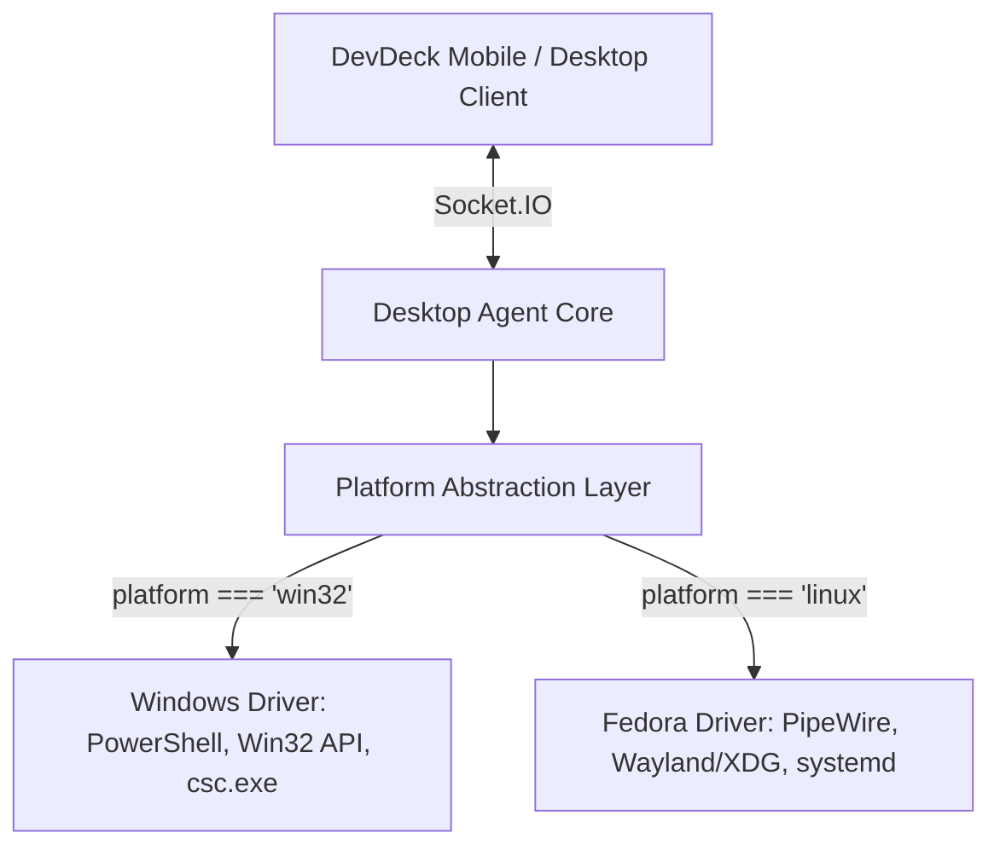

# DevDeck Linux (Fedora) Port Implementation Plan

> **Target Platform**: Fedora Workstation (39/40/41+)  
> **Environment Standards**: Wayland, PipeWire, FreeDesktop XDG, systemd  
> **Target Components**: `desktop-agent` (Node.js/TypeScript) & `client` (Flutter)

---

## 1. Executive Summary

DevDeck currently relies on Windows-specific technologies (`powershell.exe`, Win32 API, `csc.exe`, and Windows Registry). Porting DevDeck to Linux Fedora requires decoupling OS-specific logic into a modular **Platform Driver Pattern** and implementing Linux-native tools compliant with modern Fedora desktop standards (Wayland and PipeWire).



---

## 2. Windows vs. Linux Fedora Technical Mapping

| Feature | Windows Current Implementation | Fedora Linux Target Implementation | Fedora Packages Needed |
| :--- | :--- | :--- | :--- |
| **URL Launcher** | `cmd /c start "" <url>` | `xdg-open "<url>"` | `xdg-utils` *(default)* |
| **Clipboard Sync** | PowerShell `Get-Clipboard` / `Set-Clipboard` | `wl-paste` / `wl-copy` (Wayland) or `xclip` (X11) | `wl-clipboard` / `xclip` |
| **Volume Control** | `keypresser.exe` (Win32 virtual keys 173-175) | PipeWire `wpctl set-volume` & `wpctl set-mute` | `wireplumber` *(default)* |
| **Brightness Control** | PowerShell WMI (`WmiMonitorBrightness`) | `brightnessctl set +10%` / `-10%` | `brightnessctl` |
| **App Discovery** | Windows Registry (`HKLM/HKCU...App Paths`) | Scan FreeDesktop `.desktop` files in `/usr/share/applications` | Core system files |
| **App Icon Extraction** | Win32 `PrivateExtractIcons` via PowerShell | Parse FreeDesktop Icon Theme (`/usr/share/icons/hicolor`) | Core system files |
| **Window Focus** | Win32 `SetForegroundWindow` via PowerShell | `gtk-launch` / DBus / `wmctrl` | Native DBus / `wmctrl` |
| **SQLite Driver** | `better_sqlite3.node` (Windows PE x64) | `better_sqlite3.node` (Linux ELF x64) | Built with `npm rebuild` |
| **Daemon/Autostart** | Inno Setup startup registry | `systemd --user` service unit | `systemd` *(default)* |
| **Distribution** | Standalone `.exe` & Inno Setup installer | Standalone ELF binary & RPM / installer script | `rpm-build` / `pkg` |

---

## 3. Detailed Architecture & Implementation Steps

### Phase 1: Architecture Refactoring & OS Abstraction

#### 1.1 Platform Router
Create `src/core/platform/platform.ts`:
- Detect running OS (`process.platform === 'win32'` vs `'linux'`).
- Detect display server on Linux (`process.env.WAYLAND_DISPLAY` ? Wayland : X11).

#### 1.2 Modular Driver Interfaces
Define standard interfaces for OS-specific features:
- `IClipboardDriver`: `read(): Promise<string>`, `write(text: string): Promise<void>`
- `ISystemControlDriver`: `setVolume(delta: number)`, `toggleMute()`, `adjustBrightness(delta: number)`
- `IAppLauncherDriver`: `listInstalledApps()`, `listRunningApps()`, `launch(appId: string)`, `extractIcon(path: string)`
- `IWindowManagerDriver`: `focusWindow(keywords: string[])`

---

### Phase 2: Linux Fedora Driver Implementations

#### 2.1 URL Launcher (`src/utils/open.ts`)
Replace the Windows `start` command with standard `xdg-open`:
```typescript
export function openUrl(url: string): Promise<void> {
  return new Promise((resolve, reject) => {
    const cmd = process.platform === 'win32'
      ? `start "" "${url.replace(/["^&]/g, (match) => `^${match}`)}"`
      : `xdg-open "${url.replace(/"/g, '\\"')}"`;

    exec(cmd, (err) => err ? reject(err) : resolve());
  });
}
```

#### 2.2 Clipboard Synchronization (`src/services/clipboardService.ts`)
Fedora uses Wayland by default on GNOME. The driver will dynamically select the appropriate tool:
- **Wayland**:
  - Read: `wl-paste --no-newline`
  - Write: Spawning `wl-copy` with stdin stream
- **X11 Fallback**:
  - Read: `xclip -selection clipboard -o`
  - Write: Spawning `xclip -selection clipboard` with stdin stream

#### 2.3 Audio & Brightness Controls (`src/socket/socketEvents.ts`)
Fedora standardizes on PipeWire for all audio routing:
- **Volume Up**: `wpctl set-volume @DEFAULT_AUDIO_SINK@ 5%+`
- **Volume Down**: `wpctl set-volume @DEFAULT_AUDIO_SINK@ 5%-`
- **Volume Mute**: `wpctl set-mute @DEFAULT_AUDIO_SINK@ toggle`
- **Brightness Up / Down**: `brightnessctl set +10%` / `brightnessctl set 10%-`

#### 2.4 Application Discovery & Icon Resolution (`src/services/appDiscoveryService.ts`)
On Linux, applications declare metadata via `.desktop` files conforming to the FreeDesktop specification:
1. **Search Directories**:
   - System: `/usr/share/applications/`
   - User: `~/.local/share/applications/`
   - Flatpaks: `/var/lib/flatpak/exports/share/applications/` and `~/.local/share/flatpak/exports/share/applications/`
2. **Parser**:
   - Parse `Name=`, `Exec=`, `Icon=`, and `NoDisplay=false`.
3. **Icon Resolution**:
   - Find icon matching `Icon=` in `/usr/share/icons/hicolor/{scalable,512x512,128x128}/apps/` or `/usr/share/pixmaps/`.
   - Read image file and convert to Base64 data URL for mobile client streaming.

#### 2.5 Window Focus & Launching (`src/utils/windowManager.ts`)
- **Wayland**: Direct foreign window focus is restricted by Wayland security policy. Use `gtk-launch <desktop-id>` or DBus application activation interface.
- **X11**: `wmctrl -x -a <app_name>`.

---

### Phase 3: Binary Compilation & Native Addons

#### 3.1 `better-sqlite3` Native Addon for Linux
`better-sqlite3` is a C++ node addon that must be compiled or downloaded for `linux-x64`:
- Prebuild download:
  ```bash
  npx prebuild-install --target=22.0.0 --platform=linux --arch=x64 --runtime=node
  ```
- Store the binary under `desktop-agent/lib-native/better_sqlite3_linux_node22.node`.

#### 3.2 Packaging via `@yao-pkg/pkg`
Add a Linux packaging script (`build-linux.js`):
```bash
npx @yao-pkg/pkg . --targets node22-linux-x64 --output build/devdeck-agent-linux
chmod +x build/devdeck-agent-linux
```

---

### Phase 4: Fedora System Integration & Packaging

#### 4.1 Systemd User Service (`devdeck-agent.service`)
Allow running the agent headlessly in the background without keeping a terminal open:
```ini
[Unit]
Description=DevDeck Desktop Agent
After=network.target sound.target

[Service]
Type=simple
ExecStart=%h/.local/bin/devdeck-agent
Restart=on-failure
RestartSec=3
Environment=NODE_ENV=production

[Install]
WantedBy=default.target
```

Commands:
```bash
systemctl --user daemon-reload
systemctl --user enable --now devdeck-agent
```

#### 4.2 One-Command Fedora Installer Script (`install-fedora.sh`)
Automate setup for Fedora users:
1. Verify / install prerequisites via DNF:
   ```bash
   sudo dnf install -y wl-clipboard brightnessctl wireplumber
   ```
2. Copy binary to `~/.local/bin/devdeck-agent`.
3. Install and start the systemd user service.

---

### Phase 5: CI/CD Pipeline Automation

Update `.github/workflows/release.yml` to add a parallel Linux build job:

```yaml
  build-linux:
    runs-on: ubuntu-latest
    steps:
      - name: Checkout Code
        uses: actions/checkout@v4

      - name: Set up Node.js
        uses: actions/setup-node@v4
        with:
          node-version: '22'
          cache: 'npm'
          cache-dependency-path: desktop-agent/package-lock.json

      - name: Install Dependencies
        working-directory: desktop-agent
        run: npm ci

      - name: Compile TypeScript
        working-directory: desktop-agent
        run: npm run build

      - name: Package Linux Binary
        working-directory: desktop-agent
        run: node build-linux.js

      - name: Create Release Tarball
        run: |
          tar -czvf devdeck-agent-linux-x64.tar.gz -C desktop-agent/build devdeck-agent-linux

      - name: Upload Artifact
        uses: actions/upload-artifact@v4
        with:
          name: devdeck-linux-agent
          path: devdeck-agent-linux-x64.tar.gz
```

---

### Phase 6: (Optional) Flutter Linux Client

If you want the **DevDeck remote deck interface** to also run as a native window on Fedora:
1. Run in repository root:
   ```bash
   flutter create --platforms=linux .
   ```
2. Required packages on Fedora for Flutter compilation:
   ```bash
   sudo dnf install clang cmake ninja-build gtk3-devel pkgconf
   ```
3. Build release executable:
   ```bash
   flutter build linux --release
   ```

---

## 4. Suggested Implementation Roadmap

1. **Step 1**: Implement `platform.ts` and update `open.ts` + `clipboardService.ts` to support Linux tools.
2. **Step 2**: Add PipeWire volume and `brightnessctl` commands in `socketEvents.ts`.
3. **Step 3**: Implement the `.desktop` file parser in `appDiscoveryService.ts`.
4. **Step 4**: Create `build-linux.js` and configure Linux `better-sqlite3` native addon fetching.
5. **Step 5**: Write `devdeck-agent.service` and the `install-fedora.sh` installer script.
6. **Step 6**: Add the Linux build job to `.github/workflows/release.yml`.
